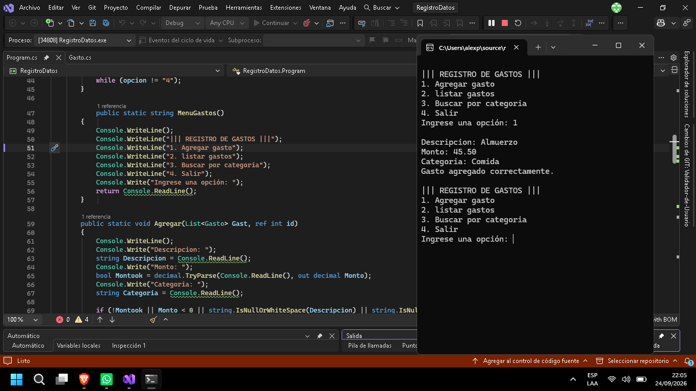
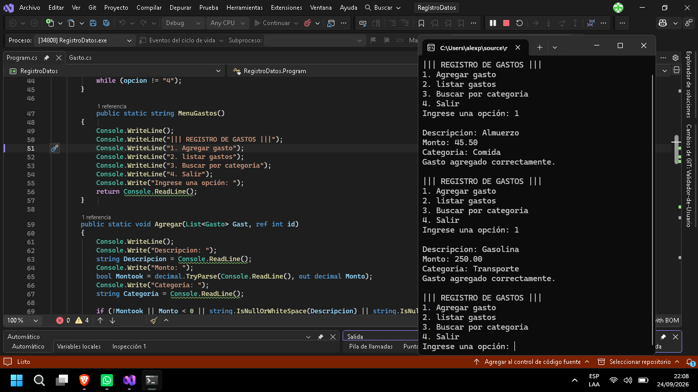
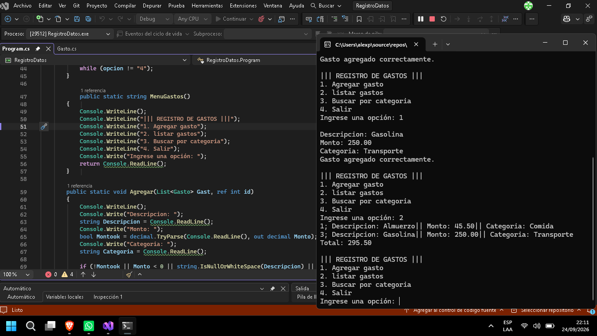
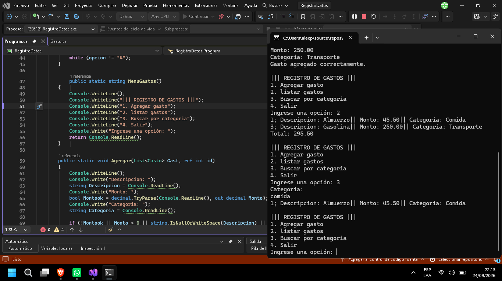
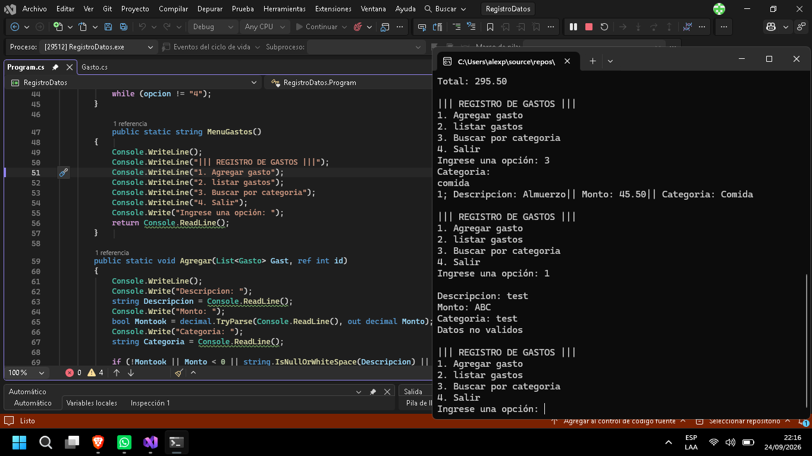
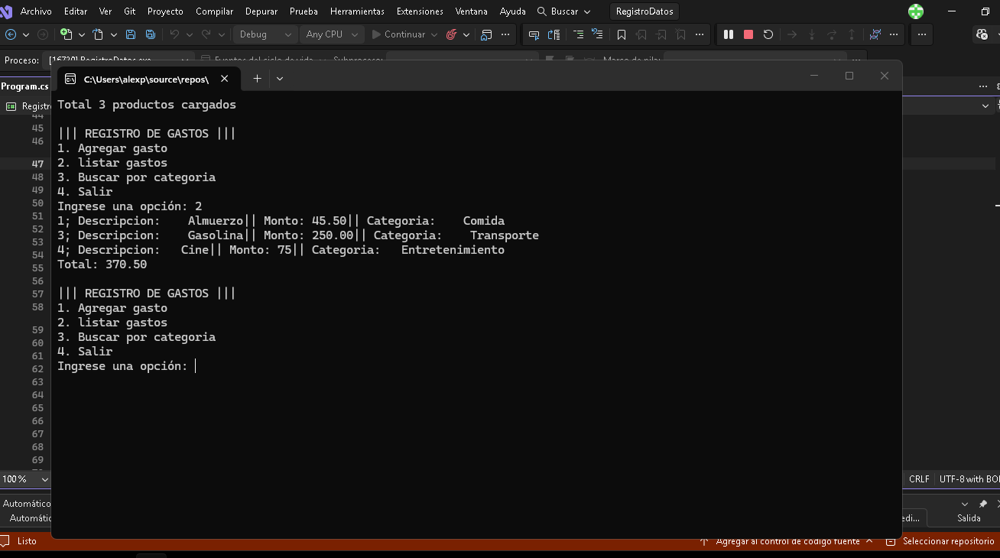

# Nombre del proyecto ||| Registro de gastos
## Pasos para ejecutar el program.cs
- | abrir visual studio community 2026
- | Presionar "F5" para ejecutar el proyecto
- | ingresar los datos

# Capturas

